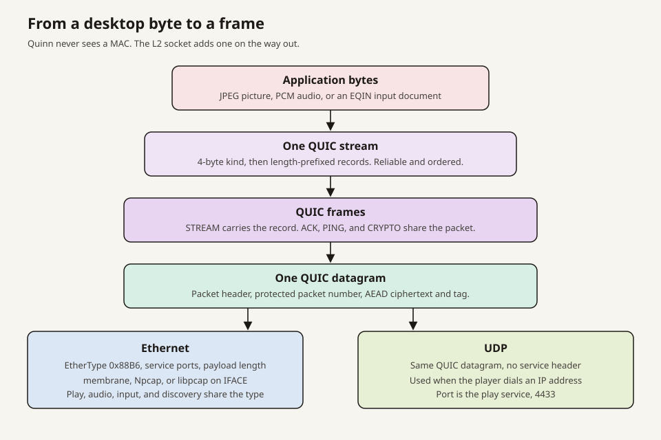
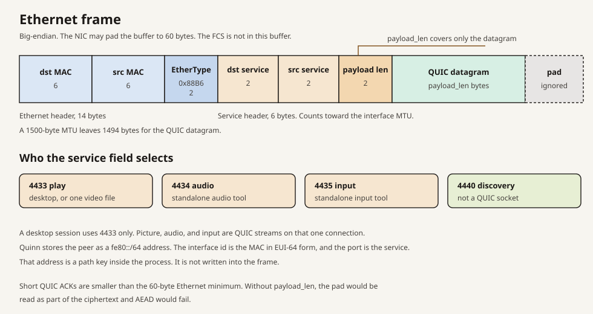
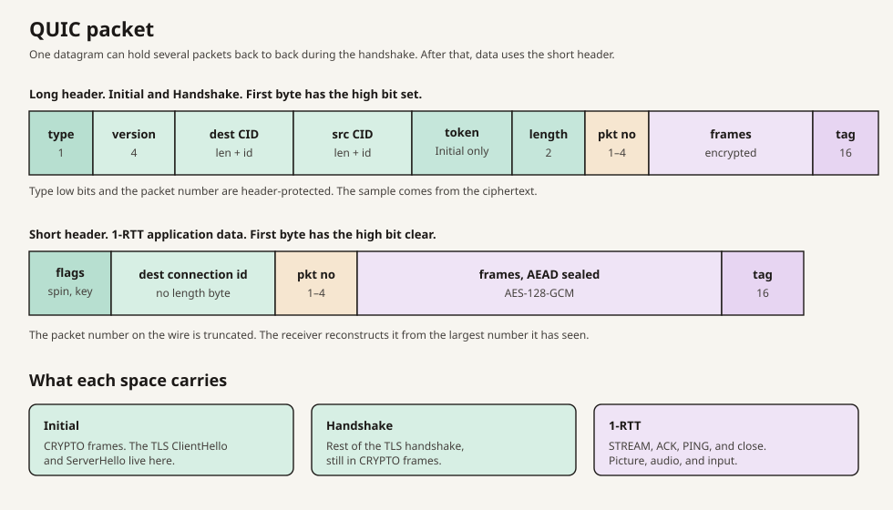
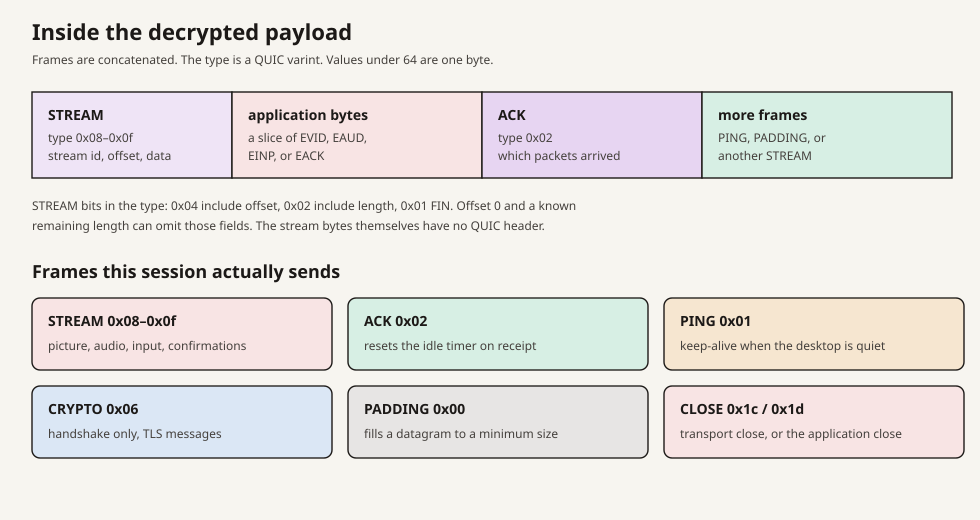
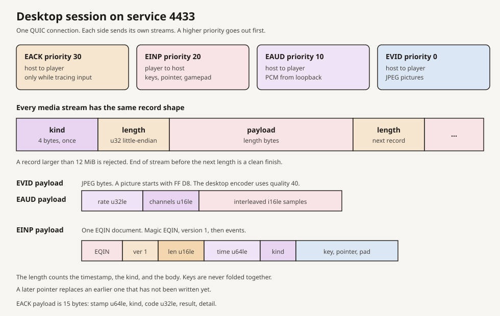
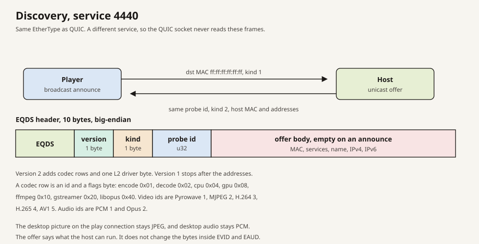

# Architecture

QUIC datagrams on Ethernet. The diagrams below are the bytes on the wire. Addresses in examples are the placeholders `SENDER_MAC`, `PEER_MAC`, and `IFACE`.

The desktop path and the file tools both end in one Quinn datagram. On Ethernet that datagram is the payload of an `0x88B6` frame. On UDP it is the UDP payload, with no service header. Quinn's path address is a `fe80::/64` key derived from the MAC. It is not transmitted.

## Ethernet frame

| Field | Bytes | Order | Meaning |
| --- | --- | --- | --- |
| Destination MAC | 6 | big-endian | Peer, or `ff:ff:ff:ff:ff:ff` for a discovery announce |
| Source MAC | 6 | big-endian | Sender |
| EtherType | 2 | big-endian | `0x88B6` |
| Destination service | 2 | big-endian | Which socket receives the datagram |
| Source service | 2 | big-endian | Sender's service |
| Payload length | 2 | big-endian | Length of the datagram that follows |
| Payload | `payload_len` |  | One QUIC datagram, or one discovery message |
| Pad | rest of the buffer |  | NIC padding up to 60 bytes. Not part of the payload |

The 14-byte Ethernet header sits outside the interface MTU. The 6-byte service header sits inside it, so a 1500-byte MTU leaves 1494 bytes for the QUIC datagram. The frame check sequence is added by the adapter and is not part of this layout.

`payload_len` exists because a short QUIC ACK is smaller than the 60-byte Ethernet minimum. The pad would otherwise be fed to AEAD and the packet would fail to open.

Service `4433` is the play connection on Ethernet and the video lab tool. `4434` is the audio lab tool. `4435` is the input lab tool. `4440` is discovery and is not a QUIC socket. On UDP, play asks for `4433` and binds the next free port when another program holds it, up to 16 ports later. When only `4433` is taken, that port is `4434`, which is also the audio lab tool's service. Discovery announces the port play actually bound. A desktop session is one QUIC connection. Picture, sound, and input are streams on that connection.

The L2 socket is membrane (`\\.\MembraneNdis`) when that device is open, otherwise Npcap on Windows, libpcap on Linux, and BPF plus AF_NDRV on macOS. The macOS host LaunchDaemon (`dev.etherquic.host`) runs as root so BPF opens. An in-memory fabric stands in for the adapter during tests. All four carry the same frame.

## QUIC packet

The datagram is one or more QUIC packets. Handshake flight often coalesces an Initial and a Handshake into one datagram. Application data uses the short header.

A long-header packet starts with the high bit set: type, 4-byte version, destination and source connection ids, an Initial token when the type is Initial, a 2-byte length, a 1 to 4 byte packet number, then the sealed frames and a 16-byte AES-128-GCM tag. A short-header packet is the flags byte (spin and key phase), the destination connection id, the packet number, and the same sealed body.

Header protection hides the low bits of the first byte and the packet number. The mask is taken from the ciphertext. The packet number on the wire is truncated. The receiver expands it from the highest number it has already accepted.

TLS runs inside `CRYPTO` frames. The Initial space carries the start of the handshake. The Handshake space carries the rest. The 1-RTT space carries the desktop. The pure-Rust provider is AES-128-GCM. There is no `ring` or `aws-lc` on this path.

## Frames inside the packet

After AEAD opens the packet, the plaintext is a sequence of frames. The type is a QUIC variable-length integer. The types this session uses:

| Type | Value | Role |
| --- | --- | --- |
| PADDING | `0x00` | Fills a datagram out to a minimum size |
| PING | `0x01` | Keep-alive when the desktop is not sending |
| ACK | `0x02` | Packet numbers the peer has received |
| CRYPTO | `0x06` | TLS handshake bytes |
| STREAM | `0x08`–`0x0f` | Application records |
| CONNECTION_CLOSE | `0x1c` | Transport close |
| APPLICATION_CLOSE | `0x1d` | Peer closed the session on purpose |

A STREAM type byte also carries three flags: `0x04` means an offset is present, `0x02` means a length is present, and `0x01` means the stream is finished. The stream id follows, then the optional offset and length, then the raw application bytes. Those bytes have no second header.

An ACK is what resets the idle timer. A sent PING does not. The negotiated idle timeout is the smaller of the two peers' offers, so a quiet desktop stays up only while PINGs are still being answered.

## Desktop records

The host opens the picture stream and the audio stream before it accepts input, so a confirmation cannot be mistaken for one of those two. The player opens the input stream. Each stream is unidirectional and starts with a 4-byte kind, written once:

| Kind | Direction | Send priority | Payload |
| --- | --- | --- | --- |
| `EACK` | host to player | 30 | 15-byte confirmation, and only when input tracing is on |
| `EINP` | player to host | 20 | one EQIN document |
| `EAUD` | host to player | 10 | PCM |
| `EVID` | host to player | 0 | one JPEG, on the original stream |

After the kind, every record is a little-endian `u32` length and then that many bytes. A record over 12 MiB is rejected. A clean end of stream before the next length finishes that stream.

The live path negotiates PyroWave, MJPEG, or H.264. H.265 and AV1 hardware sit ahead of those in the preference list, and CPU PyroWave sits last. When both ends agree on ALPN `etherquic/2`, the picture stream is `EVI2` and the audio stream is `EAU2`: a config record, then coded bytes. Quality applies to MJPEG.

An original `EVID` payload is a JPEG. The decoder treats `FF D8` as JPEG and an `EINT` prefix as an intra frame. An original `EAUD` payload is a little-endian sample rate (`u32`), a channel count (`u16`), and interleaved `i16` samples.

An `EINP` payload is an EQIN document: `EQIN`, version `1`, then events. Each event is a little-endian `u16` length, a `u64` timestamp in microseconds, a kind byte, and a body. The length counts the timestamp, the kind, and the body. Kinds are key `1`, pointer `2`, delta `3`, gamepad `4`, and sync `5`. Bytes that have not been handed to the stream yet may be folded: a later pointer replaces an earlier one, and a later gamepad snapshot replaces the earlier snapshot of that pad. Keys are kept in order.

An `EACK` payload is 15 bytes: the echoed timestamp, a kind, a little-endian `u32` code, a result, and a detail byte. A zero timestamp is not confirmed.

## Discovery

Discovery uses the Ethernet frame above and does not use QUIC. The player broadcasts a burst of announces. The host answers each one in a unicast offer. The round trip of those answers is the latency sample.

The payload starts with 10 bytes: `EQDS`, a version byte, a kind byte, and a big-endian probe id. Kind `1` is an announce and has an empty body. Kind `2` is an offer. The offer body is the host MAC, the L2 service, the UDP port, a name, then up to four IPv4 addresses and four IPv6 addresses.

Version `1` ends there. Version `2` continues with a video list, an audio list, and one L2 driver byte (`1` libpcap, `2` Npcap, `3` membrane). Each codec row is an id and a flags byte:

| Bit | Flag |
| --- | --- |
| `0x01` | hardware encode |
| `0x02` | hardware decode |
| `0x04` | CPU path |
| `0x08` | GPU compute |
| `0x10` | ffmpeg |
| `0x20` | GStreamer |
| `0x40` | libopus |

Video ids are Pyrowave `1`, MJPEG `2`, H.264 `3`, H.265 `4`, AV1 `5`. Audio ids are PCM `1` and Opus `2`. Those rows describe the host. The live session picks from that catalog. A desktop settles on PyroWave, MJPEG, or H.264.

## File tools

`video/`, `audio/`, and `input/` are lab tools. They are useful, and they are not the remote-desktop session. The video tool copies one file on one stream. The bytes are the file, not LOC objects, on service `4433`. The audio tool puts Opus in LOC objects on service `4434`. The input tool sends EQIN documents on service `4435`. One LOC object is a group id, a subgroup id, an object id, public properties, private properties, and a payload. The layout is in [container/README.md](container/README.md).

The video tool's service `4433` is the same service a host listens on. On a machine that is also hosting, that listener is the one that collides.

On a connection that carries more than one of those tools, send priority is input 20, audio 10, video 0.

## Where this lives

| Bytes | Code |
| --- | --- |
| Ethernet frame | `src/frame.rs` |
| MAC used as a Quinn path address | `src/addr.rs` |
| L2 socket and the 6-byte service header | `src/l2_endpoint.rs` |
| UDP socket, no service header | `src/udp_endpoint.rs` |
| Discovery payload | `src/discover.rs` |
| Stream priorities | `src/priority.rs` |
| `EVID`, `EAUD`, `EINP` records | `play/src/wire.rs`, `play/src/session.rs` |
| JPEG and intra pictures | `play/src/picture.rs` |
| Negotiated picture codecs | `play/src/codec.rs`, `media/` |
| EQIN events | `input/src/event.rs` |
| `EACK` confirmations | `play/src/ack.rs` |
| LOC objects | `container/src/object.rs` |
| QUIC packet and frame codec | `vendor/quinn/quinn-proto` |

Capture writes `ether.pcap` for these frames and `app.pcap` for the records. `wireshark/etherquic.lua` decodes both.
